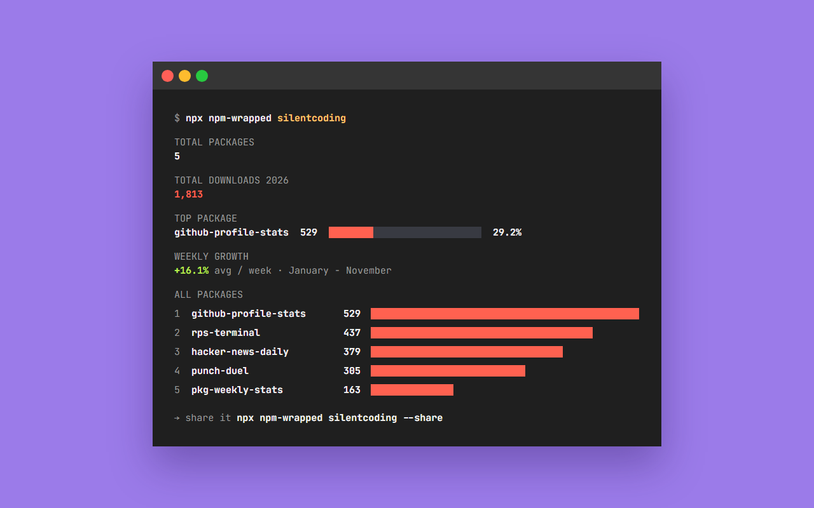

# NPM Wrapped

Your npm year in review. Total downloads, top package and weekly growth, plus a card you can share.



## Usage

```bash
npx npm-wrapped <username>
```

```
npx npm-wrapped <username>              Your stats for this year
npx npm-wrapped <username> --share      Save a share card
npx npm-wrapped <username> --year 2025  Another year
```

| Option | |
| --- | --- |
| `-y, --year <year>` | Wrap another year, e.g. `2025` |
| `-s, --share` | Save the share card as SVG and open a preview with a PNG download |
| `--no-open` | Do not open the preview in the browser |
| `--json` | Print JSON |

## What you get

- **Total downloads** of every public package you maintain, from January 1 until yesterday
- **Top package** and its share of all downloads
- **Weekly growth** as a chart of every week, with the average week over week growth
- **All packages** ranked by downloads

## Share card

```bash
npx npm-wrapped <username> --share
```

Saves `<username>-<year>.svg` in the current folder and opens a preview in your browser. Use Download PNG there to get a 1080 x 1350 image for social media.

## Data

Downloads come from the [npm downloads API](https://github.com/npm/registry).

## License

MIT
